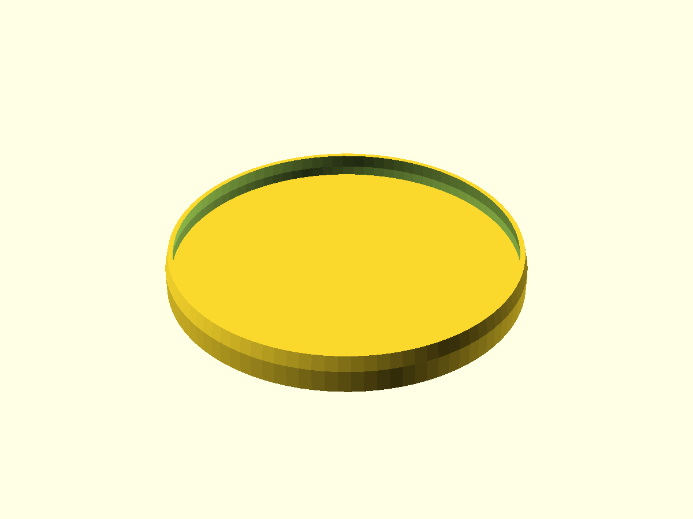
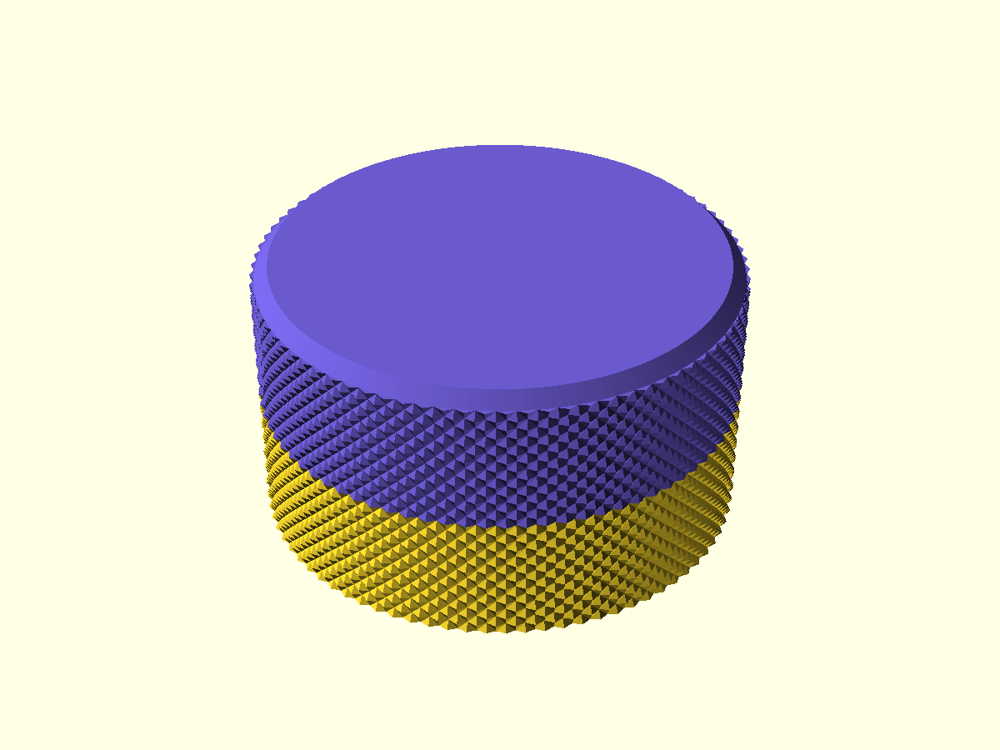
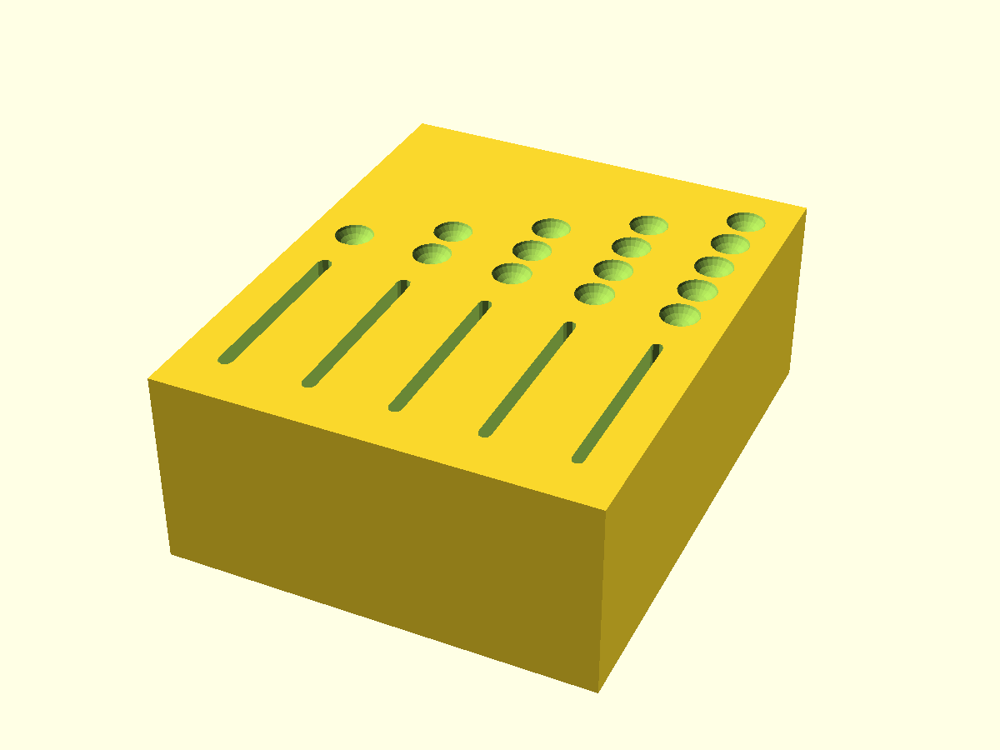
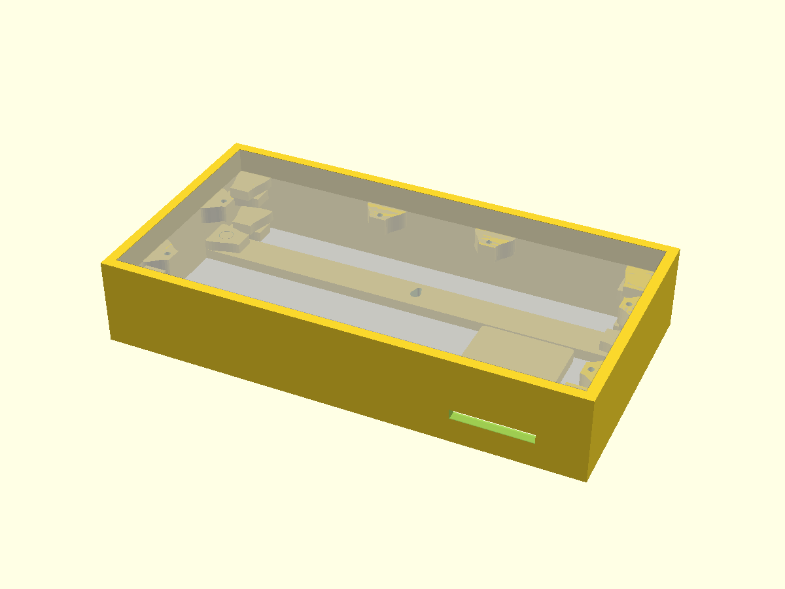
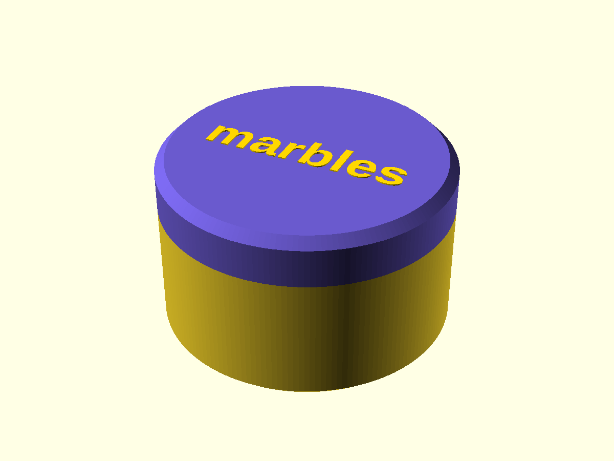
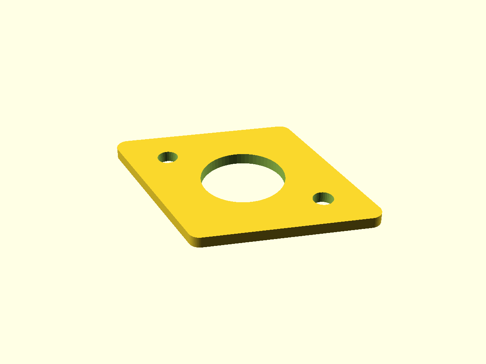
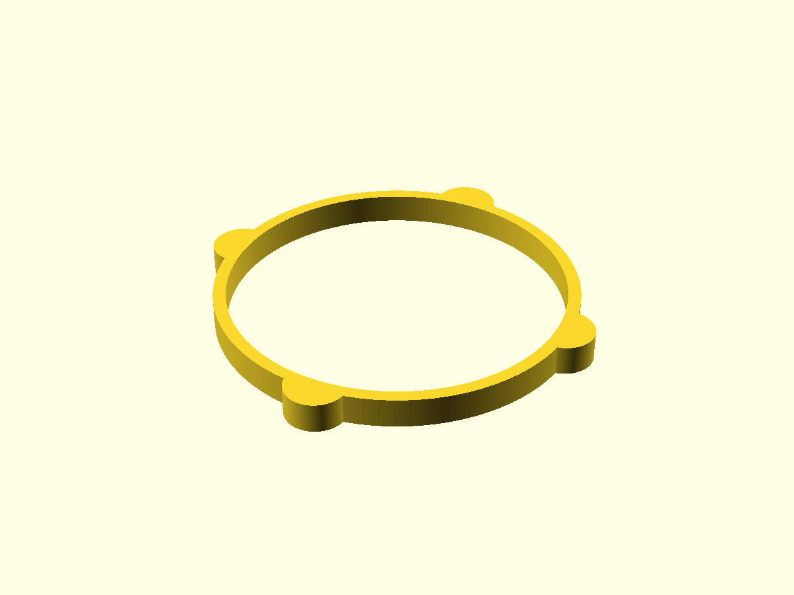
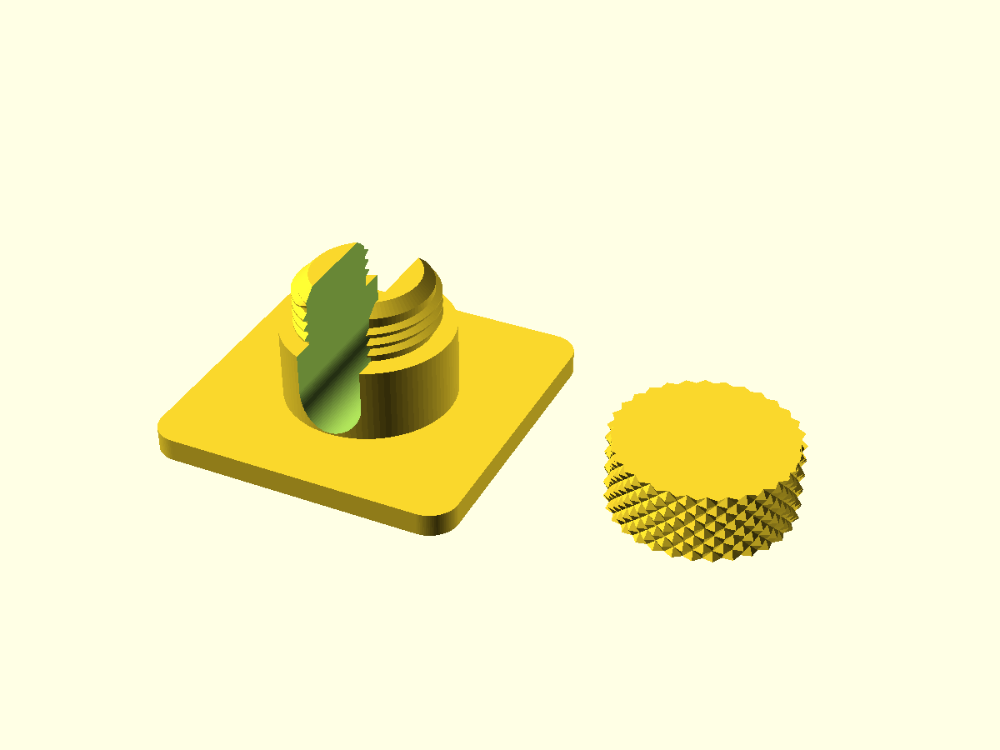

# 3D-Models

A catalog of my 3D-printable designs. Each entry below is auto-generated from
the source `.scad` files.

# Shared libraries

Reusable OpenSCAD components live under `lib/` and are not treated as
designs by the build. Pull one into your own design with `use <>`:

- [`lib/knuckles.scad`](lib/knuckles.scad) — male/female bell-curve
  "knuckle" protrusions for joining two printed parts. One carries an 8 mm
  pin, the other a matching socket; glue goes in the socket. Exposes
  `knuckle_male()`, `knuckle_female()`, `knuckle_profile()`, and
  `knuckle_pin_tip_chamfer()`. Rendering the file standalone shows a demo
  mated pair.

# Designs

<!-- designs:start -->

## dog-food-can-cap

**Source:** [can_cap.scad](dog-food-can-cap/can_cap.scad)
**3MF:** [can_cap](dog-food-can-cap/3mf/can_cap.3mf)

## gopro-battery-case

**Source:** [gopro-battery-case.scad](gopro-battery-case/gopro-battery-case.scad)
**3MF:** [base](gopro-battery-case/3mf/gopro-battery-case-base.3mf) · [lid](gopro-battery-case/3mf/gopro-battery-case-lid.3mf)

**Source:** [sd-slot-test.scad](gopro-battery-case/sd-slot-test.scad)
**3MF:** [sd-slot-test](gopro-battery-case/3mf/sd-slot-test.3mf)

## led-matrix-frame-v2

**Source:** [led-matrix-frame-v2.scad](led-matrix-frame-v2/led-matrix-frame-v2.scad)
**3MF:** [exploded](led-matrix-frame-v2/3mf/led-matrix-frame-v2-exploded.3mf) · [top_rail](led-matrix-frame-v2/3mf/led-matrix-frame-v2-top_rail.3mf) · [bottom_rail](led-matrix-frame-v2/3mf/led-matrix-frame-v2-bottom_rail.3mf) · [side_rail_left](led-matrix-frame-v2/3mf/led-matrix-frame-v2-side_rail_left.3mf) · [side_rail_right](led-matrix-frame-v2/3mf/led-matrix-frame-v2-side_rail_right.3mf) · [hanger](led-matrix-frame-v2/3mf/led-matrix-frame-v2-hanger.3mf)

## marbles-container

**Source:** [marbles-container.scad](marbles-container/marbles-container.scad)
**3MF:** [base](marbles-container/3mf/marbles-container-base.3mf) · [lid](marbles-container/3mf/marbles-container-lid.3mf) · [lid-text](marbles-container/3mf/marbles-container-lid-text.3mf)

## superwinch-adapter-plate

**Source:** [superwinch-adapter-plate.scad](superwinch-adapter-plate/superwinch-adapter-plate.scad)
**3MF:** [superwinch-adapter-plate](superwinch-adapter-plate/3mf/superwinch-adapter-plate.3mf)

## water-cartridge-spacer

**Source:** [water-cartridge-spacer.scad](water-cartridge-spacer/water-cartridge-spacer.scad)
**3MF:** [solid](water-cartridge-spacer/3mf/water-cartridge-spacer-solid.3mf) · [ventilated](water-cartridge-spacer/3mf/water-cartridge-spacer-ventilated.3mf)

## wire-mounts

**Source:** [wire_mount.scad](wire-mounts/wire_mount.scad)
**3MF:** [holder](wire-mounts/3mf/wire_mount-holder.3mf) · [cap](wire-mounts/3mf/wire_mount-cap.3mf)

<!-- designs:end -->
